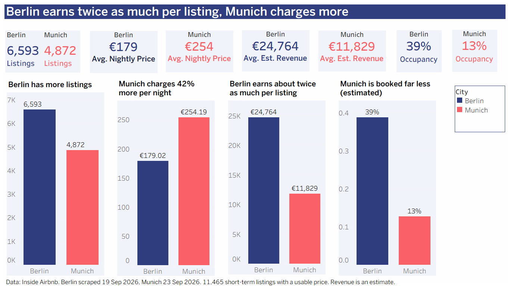

# Berlin vs Munich: Where and What to List?

**A short-term rental market analysis for a property manager, built with SQL, Python and Tableau.**

I analysed public Airbnb data for Berlin and Munich to answer a business question for a fictional client, *Sophie*, who runs a small property-management company and wants to start short-term rentals: **where should she start, and what should she offer?**

> **Dashboards (Tableau Public):** [ADD YOUR TABLEAU PUBLIC LINK HERE]



---

## Key findings

| # | Finding |
|---|---|
| 1 | **Munich charges 42% more per night (254 vs 179), but a Berlin listing earns about twice as much** (about 24.8K vs 11.8K estimated per year). Estimated occupancy is about 39% in Berlin and 13% in Munich. |
| 2 | **The best neighbourhoods earn up to 39.5K per listing in Berlin** (Schloß Charlottenburg, Prenzlauer Berg Südwest, Helmholtzplatz) **and about 25K in Munich** (Altstadt-Lehel). |
| 3 | **Hosts with several listings earn more but are rated lower.** They own 61% of Berlin's analysed listings and 39% of Munich's. |
| 4 | **Price rises with the number of guests.** Superhosts do not charge more (207 vs 213) but are rated higher (4.86 vs 4.68). |
| 5 | **The busy months differ.** Munich peaks in September, Berlin is busy from June to October. |
| 6 | **About 28% of listings cannot be booked in the next 12 months**, and three out of four of them had no review in the past year. They look dormant. |

**Recommendation for Sophie:** start in Berlin in neighbourhoods like Prenzlauer Berg and Charlottenburg; expect competition from professional hosts but compete on quality; test Munich small (one or two listings in Altstadt-Lehel) before investing.

All revenue and occupancy figures are **estimates** (see Limitations).

## Dashboards

| Dashboard | What it shows |
|---|---|
| **KPI scorecard** | Listings, price, estimated revenue and occupancy, Berlin vs Munich |
| **Where to start** | Top 10 neighbourhoods per city and a map of each city |
| **Hosts, guests and seasons** | Host types, price by number of guests, reviews per month |
| **Data you can trust** | How 19,869 listings become 11,465 analysed listings, and the data-quality checks |

Screenshots are in the `dashboards/` folder.

## Data

- **Source:** [Inside Airbnb](https://insideairbnb.com/get-the-data/), public data. Please credit Inside Airbnb when reusing.
- **Cities and dates:** Berlin (scraped 19 Sep 2026) and Munich (scraped 23 Sep 2026).
- **Size:** 19,869 listings (Berlin 12,376, Munich 7,493) and 957,556 reviews. The listings file has 90 columns; I load the 32 I need.
- **Raw files are not stored in this repository** because of their size. See `data/README.md`.

**Analysis set:** 11,465 short-term listings (Berlin 6,593, Munich 4,872) with a usable price, no price outlier (above 1,000 per night) and a minimum stay of 30 nights or less.

## How it works

```
Inside Airbnb files (Berlin, Munich)
        |
Python loader (pandas, SQLAlchemy): 32 columns, loaded unchanged as text
        |
MySQL: raw tables -> cleaning in SQL -> clean tables with flags -> analysis view
        |
CSV exports of the results
        |
Tableau Public: four dashboards, plus the recommendation
```

**Why load everything as text first?** pandas can change values silently when it guesses types. I keep the raw layer exactly as received and convert the types on purpose in SQL, where every decision is visible and can be repeated.

**Tools:** MySQL and Workbench, SQL (CTEs, window functions, views, indexes), Python (pandas, SQLAlchemy, only as a loader), Tableau, GitHub.

## Data quality (what I checked and decided)

The full list is in [`docs/data_quality_log.md`](docs/data_quality_log.md). Highlights:

- Prices were text with a "$" sign: converted to numbers.
- **6,632 listings (33%) have no price.** 82.6% of those have no bookable day in the next year. I kept them but left them out of price and revenue figures.
- 135 listings above 1,000 per night are flagged as outliers, not deleted.
- 4,014 listings require 31 or more nights and are treated as long-stay.
- Four columns are empty in the 2026 data (`instant_bookable`, `host_since`, `host_total_listings_count`, `bathrooms`) and are not used.
- Row counts were compared at every step, from the source files to Tableau.

## Repository structure

```
README.md
data/        where the data comes from (raw files are not stored here)
notebooks/   01_load_raw.ipynb: the Python loader
sql/         01_profiling ... 08_export_data_funnel: numbered SQL scripts
docs/        requirements, data-quality log, key findings, data dictionary
dashboards/  Tableau workbook and screenshots
```

## How to reproduce

1. Download `listings.csv.gz` and `reviews.csv.gz` for Berlin and Munich from Inside Airbnb and save them in `data/raw/berlin` and `data/raw/munich`.
2. In MySQL, run `CREATE DATABASE air_bnb CHARACTER SET utf8mb4;`
3. Run the notebook `notebooks/01_load_raw.ipynb` (it asks for your MySQL password).
4. Run the SQL scripts in `sql/` in order: `01` (optional profiling), `02`, `03`, `04`, then `05` for the analysis.
5. Run the export scripts `06`, `07`, `08` and open the Tableau workbook with the exported CSV files.

## Limitations

- **Revenue and occupancy are estimates** from Inside Airbnb, because Airbnb does not publish real bookings. Part of the gap between Berlin and Munich may come from the estimation method.
- Each city is a **snapshot of one day**.
- Calendar availability is not the same as bookings.
- Prices are asking prices set by hosts, as published by Inside Airbnb.
- The client, Sophie, is fictional, so the recommendation shows my method and not advice for a real company.

## Skills demonstrated

- **Business analysis:** requirements, KPI definitions, stakeholder scenario, recommendation
- **SQL:** profiling, cleaning, flags instead of deletes, views, window functions
- **Python:** a reliable data loader (ETL)
- **Tableau:** four dashboards with a consistent design and takeaway titles
- **Data quality and documentation:** a decision log and repeatable scripts

---

*Created as the final project of the WBS Coding School Data Analytics course, October 2026.*
